# Hi, I'm Nic 🐵

I'm a frontend developer and designer based in Italy.

I enjoy building interfaces where product thinking, interaction design and engineering meet, with a special attention to *accessibility*.

## Main stack
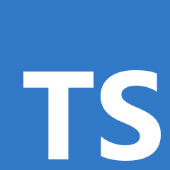 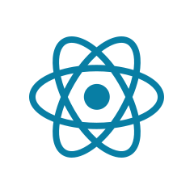 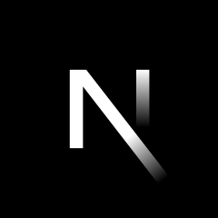 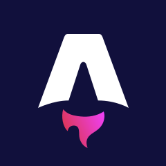 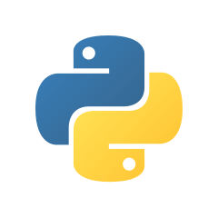 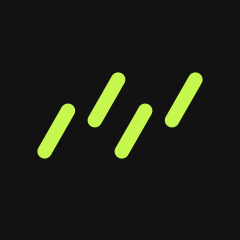 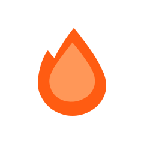    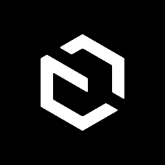 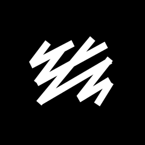   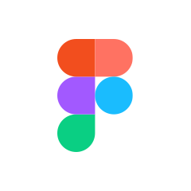 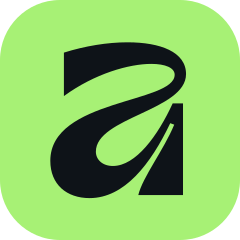

## Disclaimer
Most of my professional work is developed in private repositories for clients or agencies. If you'd like to review additional code samples or discuss implementation details, I'm happy to share selected examples during the interview process.
